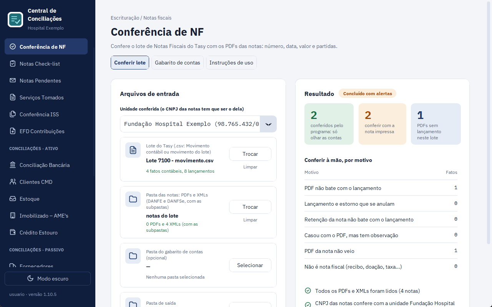
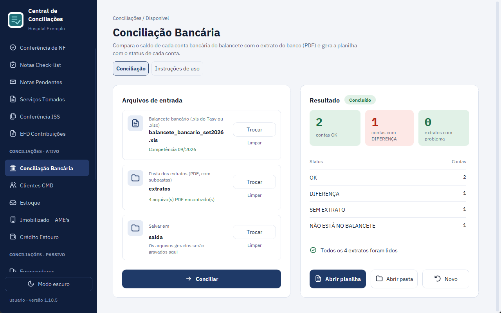
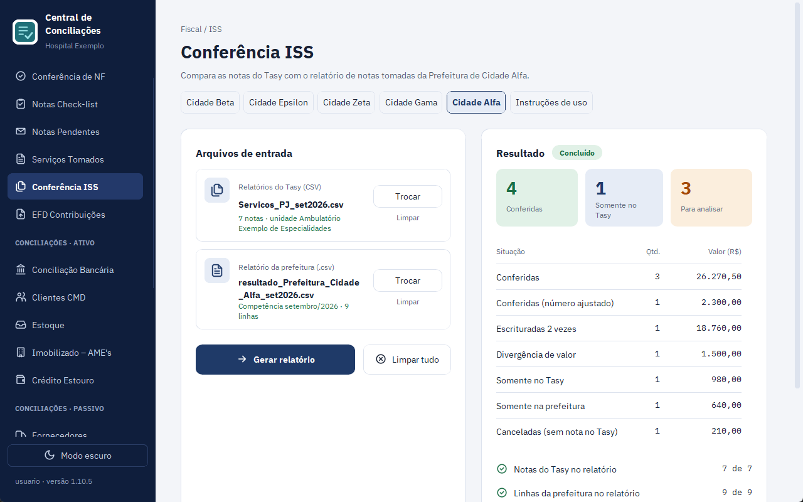
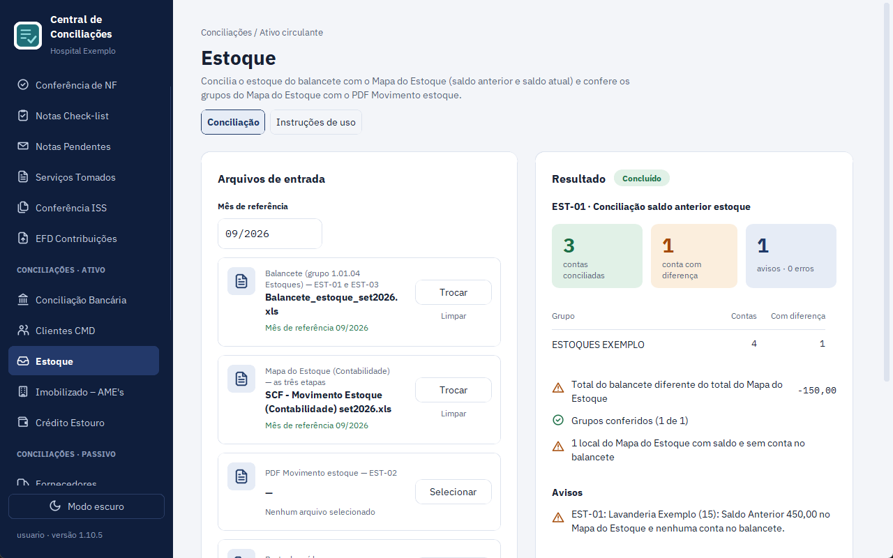
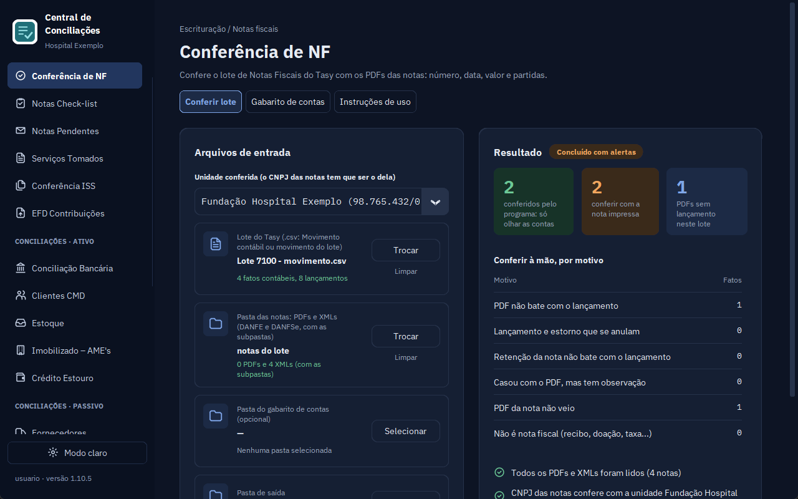

# Reconciliation Hub ("Central de Conciliações")

[Português](README.md) · **English**

A desktop application that automates the monthly account reconciliations and checks performed by the
accounting team of a non-profit hospital. It reads reports from the hospital ERP, bank statements and
invoices, cross-checks them against the accounting rules, and produces an Excel workbook ready for
review, with every discrepancy explained.



> A real project, used daily by the accounting team. This repository is an **anonymized** copy,
> published with permission: names of the institution, its units and cities, company tax IDs (CNPJ),
> people and network paths were replaced with fictitious data. Internal documents (detailed
> specifications and business rules for each area) were not published.
>
> The application itself is in Brazilian Portuguese (code, comments, UI and reports).

## The problem

Every month-end close required manually checking thousands of lines across the ERP, banks, city halls
and invoices: each bank account balance × trial balance, each invoice × journal entry, each card sale
× cash register, each termination payment × payroll. It took days, depended on whoever knew the
process, and left no record of what had been checked.

## The solution

A single window with **19 modules**, one per routine, organized like the chart of accounts:

| Section | Modules |
|---|---|
| **Tax** | Invoice check (Brazilian NF-e/NFS-e PDFs and XML × accounting batch), contract invoices checklist, pending invoices, services-taken bookkeeping (city hall import file), municipal service tax (ISS) check for 5 cities, EFD-Contribuições (Brazilian SPED tax file) |
| **Reconciliations · Assets** | Banks (PDF statements from several banks × trial balance), receivables, inventory, fixed assets, salary-advance credits |
| **Reconciliations · Liabilities** | Suppliers, terminations, medical fees, medical fees workbook, grants and projects |
| **Revenue** | Health insurance agreements |
| **Tools** | Batch PDF printing, usage history |

In each module the user picks the month's files and clicks a button. The program:

1. **reads** the input files (PDF, XML, `.xlsx`, `.xls` and `.csv` exported by the ERP, bank
   statements, city hall reports), locating columns and rows by their titles, never by fixed position;
2. **applies the reconciliation rules**, with money in `Decimal` (no rounding errors);
3. **writes an Excel workbook** with a summary, the line-by-line reconciliation, the open items and
   the list of files read. Summary counts are formulas: fixing an item in the sheet updates the
   summary automatically.

Principles shared by all modules:

- **Input files are never modified**: the program only writes to the output folder.
- **Nothing disappears silently**: every file and line shows up in the report with what happened to it.
- **One bad file never stops the run**: the error is recorded and the others are processed.
- **Discrepancies are explained**, not just flagged (e.g. "Net: ERP 49.51 × bank 49.50").

## Screens

All with fictitious data, generated by the project itself (`python -m manual.tirar_prints`).

| Bank reconciliation | Municipal service tax (ISS), 5 cities |
|---|---|
|  |  |
| **Inventory** | **Dark mode** |
|  |  |

## Architecture

```
main.py
central/              window, menu, theme, UI components, module registry, usage log
modules/<name>/       one package per module ("modulos/"), all with the same contract:
    __init__.py         module info (name, section, icon, instructions)
    painel.py           UI only (customtkinter); calls the processing code
    processamento.py    business rules (no GUI dependency)
    readers, Excel report, configuration...
testes/<name>/        tests for each module (pytest)
manual/               builds the PDF user manual with screenshots of fictitious data
```

- **Independent modules**: a module never imports another one. A broken module shows up in the menu
  with its error message, and the others keep working.
- **UI separated from logic**: `painel.py` only draws and calls `processamento.py`; the logic has no
  GUI dependency, so it is fully testable.
- **Non-blocking UI**: slow reads and network folders run in the background.
- **Shipped as a single `.exe`** (PyInstaller) to the team, with the version shown in the footer.

## Quality

- **~1,900 automated tests** (pytest) for ~56k lines of application code.
- **Real answer keys**: every module was validated line by line against spreadsheets built by hand by
  the accounting team. When migrating older programs, the rule was "the new output must be identical
  to the old one"; any difference was investigated, never "adjusted to make the test pass".
- **Step-by-step development**: each step with its own specification, tests and commit.

## Tech stack

Python 3.14 · customtkinter · openpyxl · pandas · pdfplumber · pypdfium2 · xlrd · Pillow · pytest ·
PyInstaller

## Running it

```powershell
uv venv .venv --python 3.14
.\.venv\Scripts\Activate.ps1
uv pip install -r requirements.txt
python main.py        # opens the app
pytest                # runs the tests
```

Tests that depend on the hospital's real files (answer keys) are skipped automatically when the
examples folder is missing, which is the case in this repository.

## How it was built

Built by **Mateus Souza**, from the hospital's accounting team, with **AI assistance (Claude Code)**.
The split of roles:

- **Me**: mapped each process with the team, wrote the specifications and business rules, built the
  answer keys, decided every ambiguous case and validated the results against real data.
- **The AI**: wrote most of the code and tests from those specifications, one step at a time, with a
  review at every step.

The project is now being migrated, module by module, to the institution's web system (NestJS +
Next.js), together with the IT team.

## Notice

Code published for portfolio purposes, with the institution's permission. All data in this repository
is fictitious. The IBM Plex fonts (`central/fontes/`) are distributed under the SIL Open Font License.
